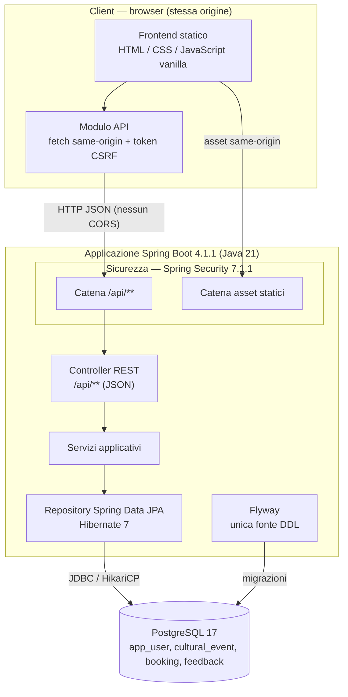
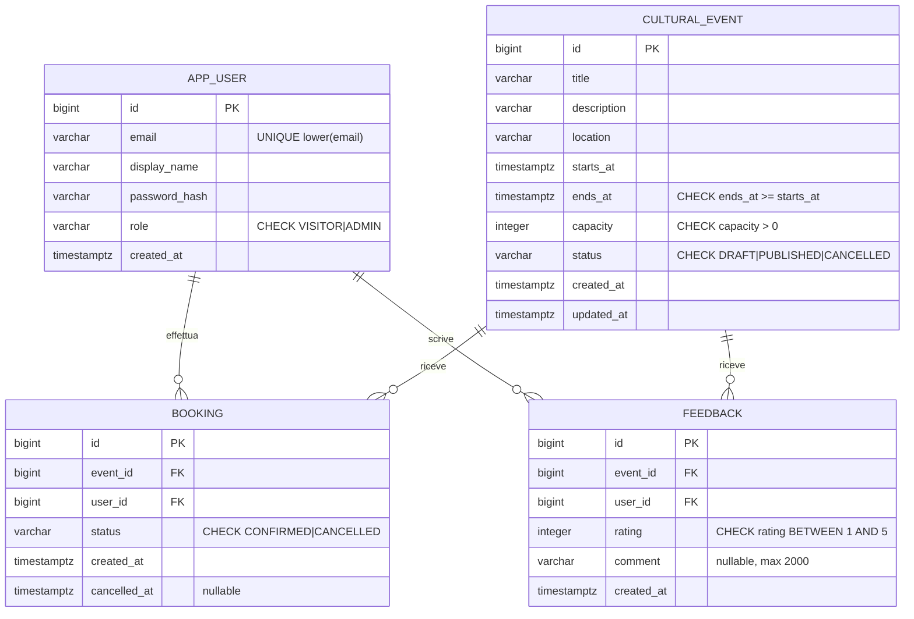
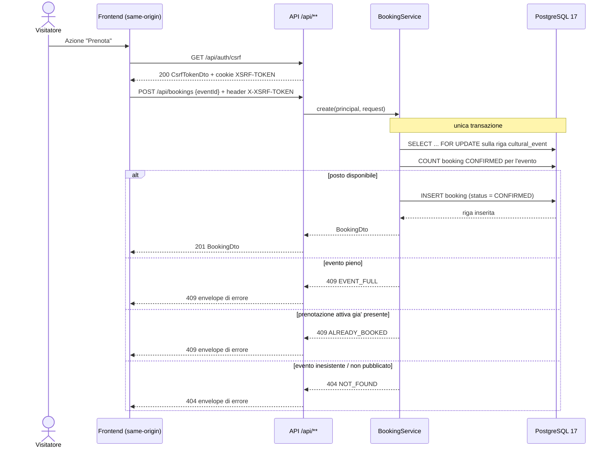
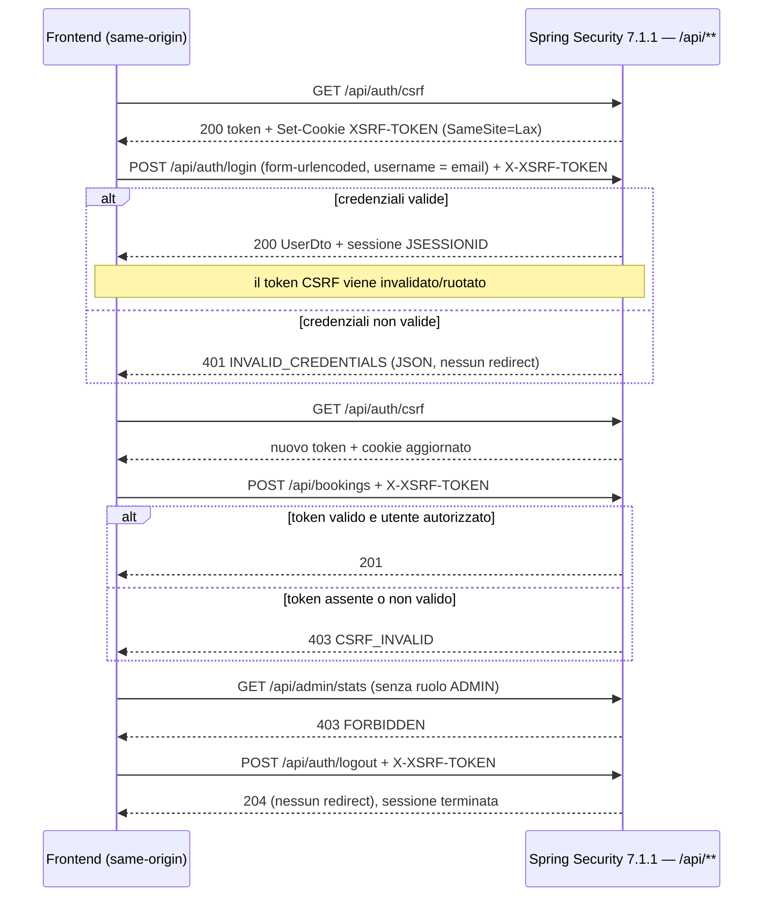

# Diagrammi di supporto — Aurora Cultura (Project Work L-31, Traccia 22)

> Documento di lavoro interno. Contiene diagrammi testuali in sintassi Mermaid, redatti a partire dai fatti di progetto (`docs/api-contract.md`, `V1__init.sql`, codice in `src/main/java/**`). I diagrammi sono materiali di supporto per il report e vanno eventualmente trasferiti nel template DOCX come immagini, senza alterare le immagini già presenti. Non sono presenti nomi, credenziali o dati personali reali.

## 1. Architettura a livelli

Note alla lettura del diagramma:

- Il frontend statico è servito dalla stessa applicazione del backend: non è prevista alcuna configurazione CORS.

- La catena di sicurezza dedicata a `/api/**` è ordinata prima della catena che serve gli asset statici.

- Flyway gestisce lo schema; Hibernate è configurato per validarlo, non per generarlo.

## 2. Modello entità-relazione del database

Lo schema deriva dalla migrazione `V1__init.sql`. I tipi sono quelli PostgreSQL; le date sono `timestamptz`.

Vincoli e indici rilevanti:

- `ux_app_user_email_lower`: indice univoco funzionale su `lower(email)`, unicità case-insensitive.
- `ux_booking_active`: indice univoco parziale su `booking (event_id, user_id) WHERE status = 'CONFIRMED'`, impedisce prenotazioni attive duplicate ma consente di riprenotare dopo un annullamento.
- `ix_booking_event_status`: indice su `(event_id, status)` usato per il conteggio dei posti occupati.
- `ix_event_status_starts`: indice su `(status, starts_at)` per la consultazione del catalogo.
- `ux_feedback_event_user`: vincolo di unicità su `feedback (event_id, user_id)`, un solo feedback per utente ed evento.

## 3. Sequenza — prenotazione di un posto

Note alla lettura:

- Il lock pessimistico sulla riga evento serializza le richieste concorrenti sullo stesso evento.
- Il conteggio delle prenotazioni confermate avviene nella stessa transazione del controllo e dell'inserimento.
- Il vincolo univoco parziale intercetta comunque la doppia prenotazione attiva concorrente; la violazione è tradotta in `409 ALREADY_BOOKED`, mai in errore interno.
- L'identità del visitatore deriva dalla sessione autenticata, non dal corpo della richiesta.

## 4. Flusso di autenticazione e protezione CSRF

Note alla lettura:

- La protezione CSRF è configurata in modalità per applicazioni a pagina singola, con cookie `XSRF-TOKEN` leggibile dal frontend e header `X-XSRF-TOKEN`.
- Il token è richiesto anche per registrazione, login e logout e viene recuperato di nuovo dopo login/logout perché viene ruotato.
- Le richieste anonime agli endpoint API ricevono `401` JSON, mai un reindirizzamento HTML; il conflitto CSRF (`403 CSRF_INVALID`) è distinto dal diniego per ruolo (`403 FORBIDDEN`).
- L'account amministratore di sviluppo è creato solo con profilo `dev` e sole variabili d'ambiente valorizzate; nessuna credenziale predefinita è presente nel repository.
